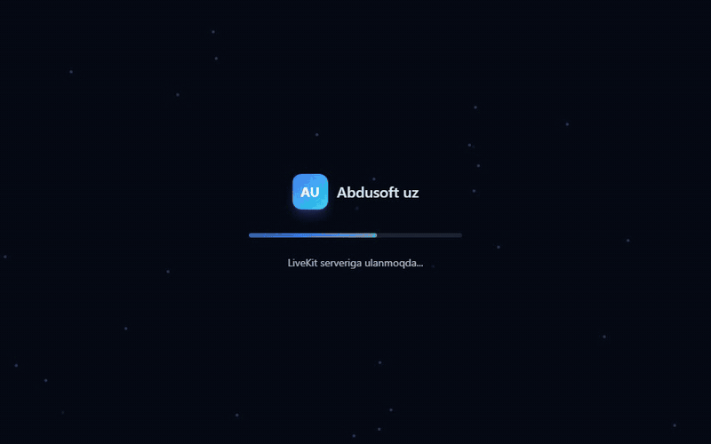
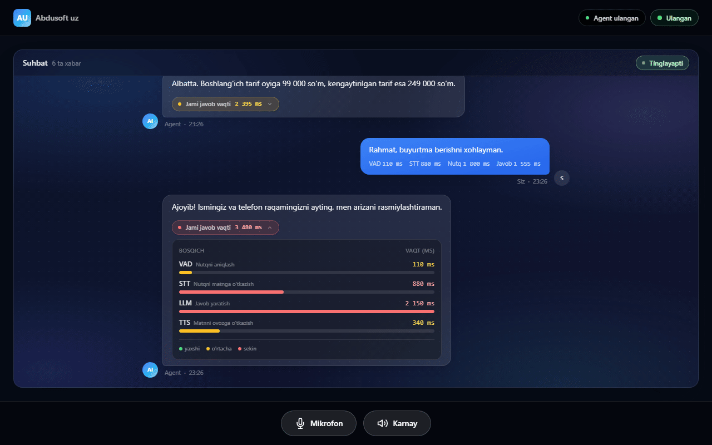
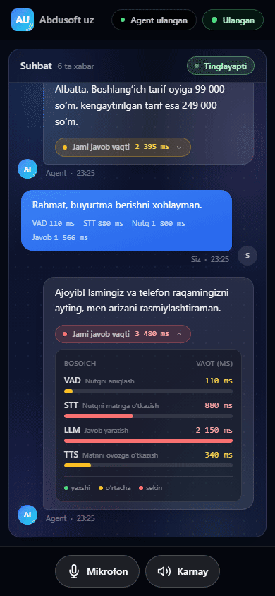
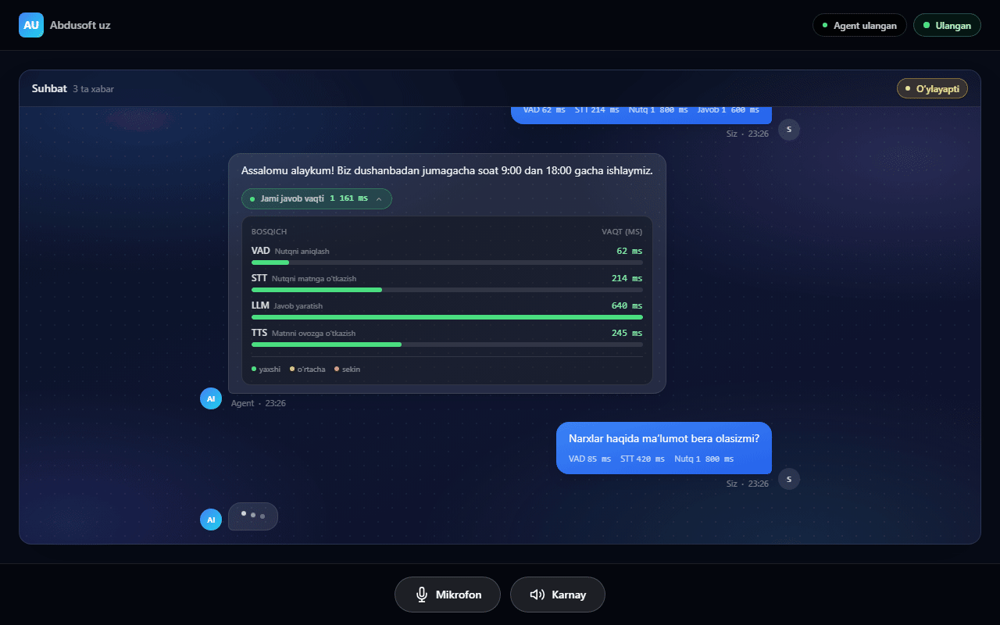
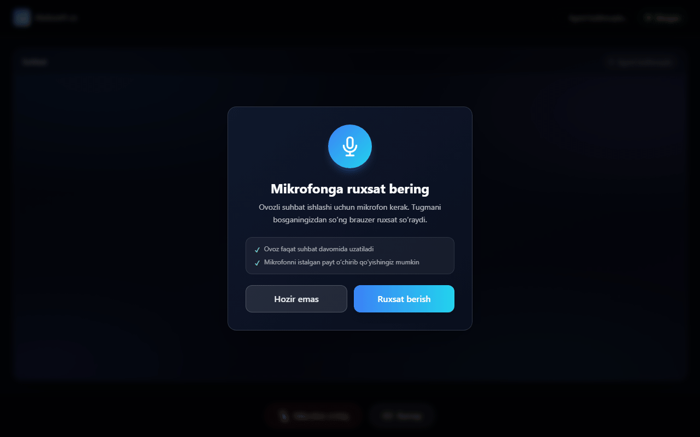
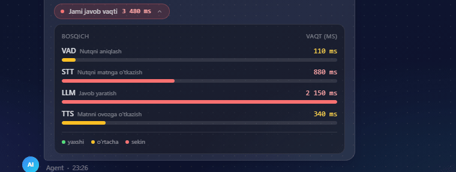

<div align="center">

# Abdusoft uz — LiveKit ovozli agent UI

**LiveKit AI agenti bilan ovozli suhbat uchun veb-interfeys: brauzer xonaga ulanadi, agent javob beradi, har bir javobning VAD → STT → LLM → TTS kechikishi millisekundlarda ko'rinadi.**


[Ko'rinish](#korinish) · [Qanday ishlaydi](#qanday-ishlaydi) · [Agent protokoli](#agent-protokoli) · [O'rnatish](#ornatish) · [Xavfsizlik](#xavfsizlik)



</div>

> [!NOTE]
> Screenshot va GIF'dagi suhbat, narxlar va millisekundlar o'ylab topilgan demo ma'lumot. Brauzer, UI, LiveKit server va WebRTC haqiqiy. "Agent" esa xonaga `demo-agent` nomi bilan qo'shilgan ikkinchi brauzer sahifasi edi. U ma'lumot kanali orqali tayyor xabarlar va metrikalarni yuborgan. Haqiqiy STT, LLM yoki TTS ishlatilmagan.

---

## Ko'rinish

<table>
<tr>
<td width="68%"></td>
<td width="32%"></td>
</tr>
<tr>
<td align="center"><sub>Suhbat: har bir javob ostida jami vaqt, ochilganda bosqichlar</sub></td>
<td align="center"><sub>Telefonda</sub></td>
</tr>
<tr>
<td></td>
<td></td>
</tr>
<tr>
<td align="center"><sub>Agent o'ylayapti: yozish pufakchasi va holat belgisi</sub></td>
<td align="center"><sub>Mikrofonga ruxsat</sub></td>
</tr>
</table>

**Kechikish paneli.** Rangi bo'yicha: yashil yaxshi, sariq o'rtacha, qizil sekin. Foydalanuvchi xabaridagi "Javob" qiymatini UI'ning o'zi o'lchaydi: gap tugagandan agent javobi kelguncha o'tgan vaqt.



## Qanday ishlaydi



1. Sahifa ochilganda brauzer `/api/token` dan LiveKit kirish tokenini oladi. Xona nomi berilmasa, tasodifiy nom yaratiladi.
2. Brauzer LiveKit serveriga WebRTC orqali ulanadi va mikrofon ruxsatini so'raydi.
3. Ulangandan keyin UI `/api/livekit/job` ga `start_agent` yuboradi. Server `AgentDispatchClient` orqali shu xonaga agent chaqiradi. Bu ishlamasa va `AGENT_WORKER_URL` berilgan bo'lsa, worker'ning `POST /start` manziliga murojaat qiladi.
4. Agent ovozni eshitadi va ovoz bilan javob beradi. Matn va metrikalarni esa LiveKit ma'lumot kanali orqali yuboradi. UI ularni suhbat oynasiga joylaydi.

Holat belgilari ("Tinglayapti", "O'ylayapti", "Gapiryapti") LiveKit voice assistant holatidan va faol so'zlovchilar hodisasidan olinadi.

## Agent protokoli

UI ma'lumot kanalidagi JSON xabarlarni o'qiydi. Agent quyidagilarni yuborishi mumkin:

| `type` | Maydonlar | UI'da nima bo'ladi |
|---|---|---|
| `user_speech` | `text`, ixtiyoriy `timestamp`, `latency.vad`, `latency.stt` | Foydalanuvchi xabari (server tomonidagi STT natijasi) |
| `agent_reply` yoki `conversation_item_added` | `text` yoki `item.content[]` (`role: "assistant"`), ixtiyoriy `latency.llm`, `latency.tts` | Agent xabari. Bir xil matn 2 soniya ichida qayta kelsa, yangi xabar qo'shilmaydi, mavjudi yangilanadi |
| `agent_speech` | `text` | Mavjud agent xabarini yangilaydi (TTS matni) |
| `pipeline_metrics` yoki `metrics_collected` | `conversation_id`, `vad`, `stt`, `llm`, `tts`, `total` (ms) | Xabar ostidagi kechikish paneli |

`pipeline_metrics` namunasi:

```json
{
  "type": "pipeline_metrics",
  "conversation_id": "conv-42",
  "vad": 110, "stt": 880, "llm": 2150, "tts": 340,
  "total": 3480
}
```

`metrics_collected` da bosqichlar `metrics.vad.duration_ms` ko'rinishida ichma-ich kelishi ham mumkin, UI ikkala shaklni tushunadi.

## O'rnatish

Kerak: **Node.js 18.18+**, LiveKit server ([LiveKit Cloud](https://livekit.io/cloud) yoki o'zingizniki) va LiveKit agent worker.

```bash
git clone https://github.com/abdusoft-uz/public-livekit-ui-example.git
cd public-livekit-ui-example
npm ci

cp env.template .env.local   # qiymatlarni o'zingiznikiga almashtiring
npm run dev                  # http://localhost:3000
```

Lokal LiveKit server bilan ishlash: [docs/LOCAL_DEVELOPMENT.md](docs/LOCAL_DEVELOPMENT.md).

| O'zgaruvchi | Majburiy | Nima uchun |
|---|---|---|
| `NEXT_PUBLIC_LIVEKIT_URL` | ha | Brauzer ulanadigan LiveKit manzili (`wss://...`). Bo'sh bo'lsa sahifa sozlash yo'riqnomasini ko'rsatadi |
| `LIVEKIT_API_KEY`, `LIVEKIT_API_SECRET` | ha | Token yaratish va agent chaqirish. Faqat serverda ishlatiladi, brauzerga yuborilmaydi |
| `LIVEKIT_HOST` | yo'q | Server API manzili (`https://...`). Bo'sh bo'lsa `NEXT_PUBLIC_LIVEKIT_URL` dan olinadi |
| `LIVEKIT_AGENT_NAME`, `NEXT_PUBLIC_LIVEKIT_AGENT_NAME` | tavsiya | Chaqiriladigan agent nomi, worker'dagi `agent_name` bilan bir xil bo'lishi kerak |
| `AGENT_WORKER_URL` | yo'q | Dispatch ishlamasa murojaat qilinadigan worker manzili |
| `LIVEKIT_JOB_ADMIN` | yo'q | `true` bo'lsa xonani boshqaruvchi job'lar yoqiladi (pastga qarang) |
| `TRUST_PROXY` | yo'q | `true` bo'lsa rate limit IP'ni `X-Forwarded-For` dan oladi. Faqat ishonchli proksi ortida yoqing |

Tekshiruv: `npm run lint` va `npm run build`.

Vercel'ga deploy qilish uchun repozitoriyani import qiling va yuqoridagi o'zgaruvchilarni loyiha sozlamalariga qo'shing.

## API

| Yo'l | Nima qiladi |
|---|---|
| `GET /api/token?roomName=&participantName=` | `{ accessToken, url }` qaytaradi. Nomlar: `A–Z a–z 0–9 . _ : -`, 64 belgigacha. Noto'g'ri nom bo'lsa `400`, boshqa metod bo'lsa `405` |
| `POST /api/livekit/job` | `{ jobType, roomName, sessionId?, payload? }`. UI faqat `start_agent` ni ishlatadi |

`/api/livekit/job` job turlari:

- `start_agent` / `start_worker`: agentni xonaga chaqiradi.
- `update_room`, `delete_room`, `list_rooms`: faqat `LIVEKIT_JOB_ADMIN=true` bo'lganda ishlaydi, aks holda `403`.
- `start_recording`, `start_transcription`, `get_room`: amalga oshirilmagan. Ular faqat izohli javob qaytaradi.

Ikkala yo'lda ham IP bo'yicha daqiqasiga 30 so'rov cheklovi bor. Undan oshsa `429` va `Retry-After` qaytadi. `payload` 8 KB dan oshmasligi kerak.

## Xavfsizlik

> [!WARNING]
> `/api/token` autentifikatsiyasiz: uni chaqirgan har kim istalgan xonaga token oladi. Bu misol loyihada ataylab shunday. Ochiq internetga chiqarishdan oldin o'z kirish tekshiruvingizni qo'shing.

Bu versiyada tuzatilganlar:

| Muammo | Endi |
|---|---|
| `next.config.js` dagi `env` bloki `LIVEKIT_API_SECRET` ni build'ga joylardi | Blok olib tashlandi. Secret faqat server muhitidan o'qiladi |
| `/api/livekit/job` worker manzilini so'rovdagi `payload.workerUrl` dan olardi (SSRF) | Manzil faqat `AGENT_WORKER_URL` dan olinadi |
| Har kim xonani o'chira yoki ro'yxatini ola olardi | Admin job'lar `LIVEKIT_JOB_ADMIN` bilan yopilgan |
| Kiruvchi nomlar tekshirilmasdi, cheklov yo'q edi | Nom tekshiruvi, payload hajmi cheklovi, rate limit |
| Token so'rovlarida ishtirokchi nomlari logga yozilardi | Production'da debug loglar o'chiq (`src/utils/logger.ts`) |
| Next.js 14.2.28 da ma'lum zaifliklar bor edi | Next.js 15.5.29 |

Qolgan cheklovlar:

- Rate limit xotirada saqlanadi va har bir instance uchun alohida hisoblanadi. Bir nechta server bo'lsa, umumiy saqlash joyi (masalan, Redis) kerak.
- UI ma'lumot kanalidagi xabarni kim yuborganini tekshirmaydi. Xonadagi istalgan ishtirokchi suhbatga matn yoki metrika qo'sha oladi.

## Optimizatsiya va dizayn

- Suhbat oynasi kichik qismlarga bo'lindi: `ChatMessageItem`, `MetricsPanel`, `chatEvents`, `metrics`. Hodisalar endi holatni o'zgartirmaydigan (pure) funksiyalarda qayta ishlanadi. Ilgari holat `.reverse()` bilan joyida buzilardi.
- Qurilmalar ro'yxati har soniyadagi so'rov o'rniga brauzer hodisasi bilan yangilanadi.
- Tailwind'dagi katta `safelist` va ishlatilmagan "glass" klasslari olib tashlandi. Fon endi CSS gradient. Ilgari `public/` da jami 3 MB'lik to'rtta JPG bor edi: faqat bittasi ishlatilardi, biri esa boshqasining aynan nusxasi edi.
- Agent belgisi endi har doim yashil emas: haqiqiy ulanishni ko'rsatadi. Soxta "Agent javob berdi" xabari va ishlamaydigan "Remote" tugmasi olib tashlandi.
- Butun UI o'zbekcha (`lang="uz"`). Klaviatura fokusi ko'rinadi, `role="log"` va `aria-live` bor. `prefers-reduced-motion` yoqilgan bo'lsa, animatsiyalar o'chadi.

## Loyiha tuzilishi

```
src/pages/index.tsx                 ulanish, sozlash va xato ekranlari
src/pages/api/token.ts              LiveKit token
src/pages/api/livekit/job.ts        agent chaqirish va job'lar
src/components/playground/          sarlavha, holat belgilari, audio tugmalar
src/components/chat/                suhbat oynasi, xabar, kechikish paneli, hodisa qayta ishlovchilari
src/components/connection/          ulanish holati
src/hooks/                          ulanish, audio, qurilmalar
src/utils/apiGuard.ts               nom tekshiruvi, IP, rate limit
src/utils/logger.ts                 production'da o'chadigan debug log
docs/                               qo'llanmalar va README rasmlari
```

Qo'shimcha qo'llanmalar:

- [LOCAL_DEVELOPMENT.md](docs/LOCAL_DEVELOPMENT.md): lokal LiveKit server bilan ishlash;
- [AGENT_WORKER_JOB_SETUP.md](docs/AGENT_WORKER_JOB_SETUP.md): agent worker'ga job yuborish;
- [AGENT_WORKER_TROUBLESHOOTING.md](docs/AGENT_WORKER_TROUBLESHOOTING.md): agent worker bilan muammolarni hal qilish.

## Litsenziya

Apache 2.0, qarang: [LICENSE](LICENSE). Loyiha bitHuman, Inc.'ning LiveKit UI misoli asosida qurilgan. Asl mualliflik va Abdusoft kiritgan o'zgarishlar [NOTICE](NOTICE) faylida yozilgan.

## Muallif

**Abdusoft uz** — [github.com/abdusoft-uz](https://github.com/abdusoft-uz) · Bobomalikov Abduaziz

Texnologiyalar: Next.js · React · TypeScript · Tailwind CSS · LiveKit (client, components, server SDK)
